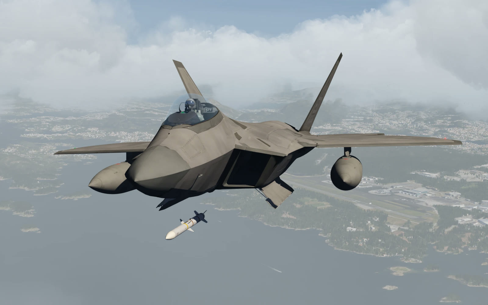
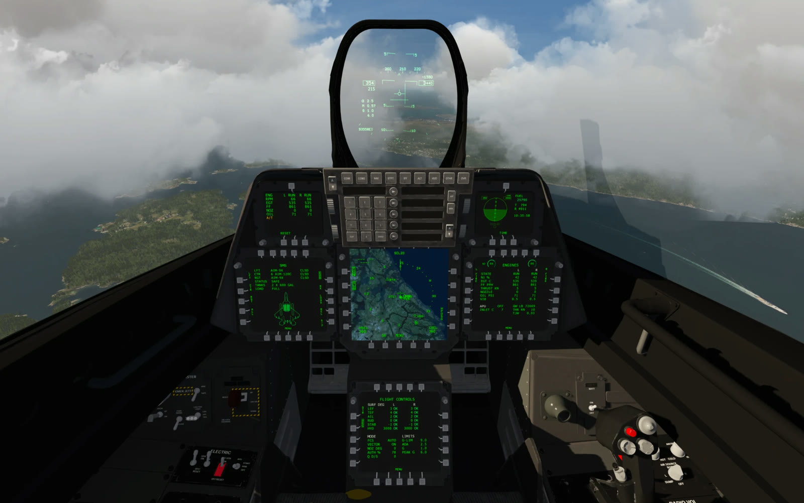
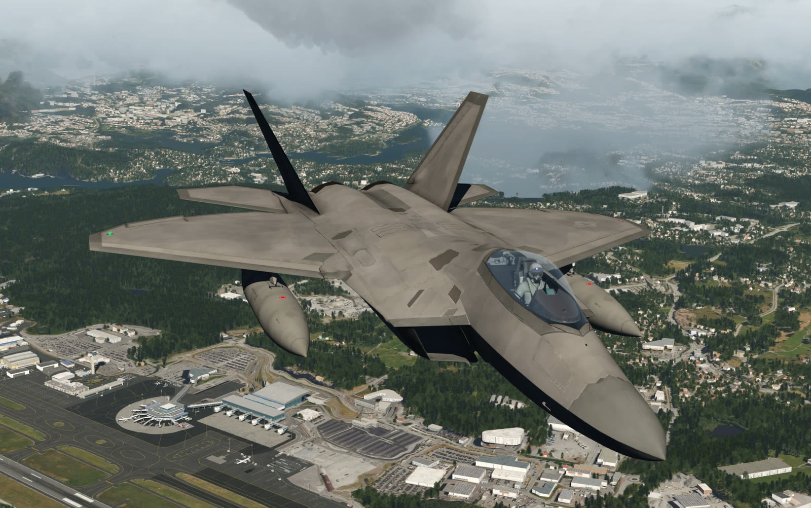
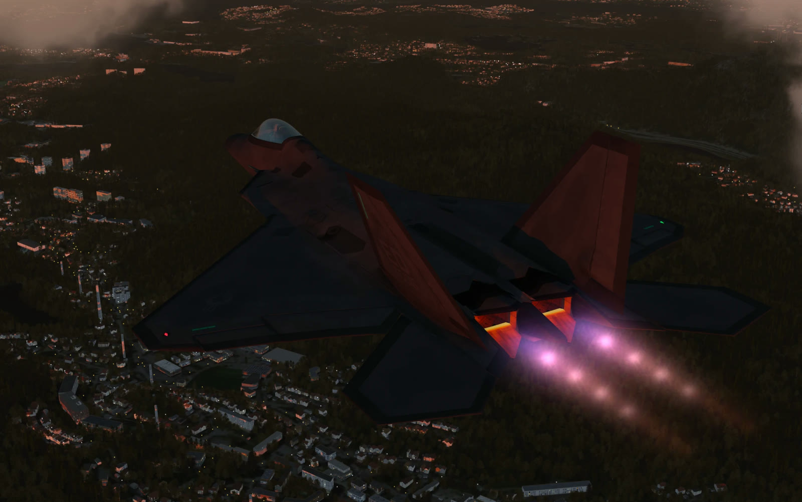

# F-22A Raptor for Aerofly FS 4

A free, open-source add-on aircraft for the desktop version of Aerofly FS 4 (Windows, macOS) - version 0.9.2.
Not affiliated with or endorsed by IPACS, Lockheed Martin, Eagle Dynamics or Grinnelli Designs.

**[Download the latest release](https://github.com/k1lyas/aerofly-fs4-f22a/releases/latest)** - unzip, run the installer, fly. How to fly it:
**GUIDE.md**. News, questions and bug reports: [the forum thread](https://www.aerofly.com/community/forum/index.php?thread/30495-f-22a-raptor-for-aerofly-fs4-work-in-progress-videos-updates-feedback-welcome/).

> **Public beta.** Developed and flown on macOS; players fly it on Windows 11 too. If something does not work, please
> tell us in the forum thread - with `f22_install.log` from your Aerofly user folder if the installer failed.

| | |
|---|---|
|  |  |

## What you get

- **Exterior and cockpit** of the F-22A (model of the Grinnelli Designs DCS World mod, GPL-3) - every switch, knob,
  key, thumbwheel and rocker moves and clicks
- **Displays**: HUD, moving map / HSI, engine (round N2 gauges), fuel, FPAS, flight control, systems, status,
  approach and weapon bay pages (the aircraft from above with its doors, missiles and tanks); live checklists; UFDs
  with ICAWS warnings, a standby attitude indicator, timer and NAV pages; ICP with radio, navigation, autopilot,
  autothrottle and load pages, HDG / CRS thumbwheels; screen modes OFF / NIGHT / DAY
- **Systems**: cold start with APU, engine start from the throttles, electrical and hydraulic systems
- **Flight**: thrust vectoring nozzles driven by the flight control laws, autothrottle, Auto-GCAS
- **Fuel and lights**: fuel burn with tank sequencing, afterburner flame and a flickering glow inside the nozzles,
  night lighting, formation lights
- **Stores**: weapon bays with AIM-120C / AIM-9X that can be released for the pictures from the SMS page (each one
  ejected or rail-launched, flying on its own glowing motor; no targets), 600 gal ferry tanks that can be jettisoned,
  also from a key; the load (clean, combat, ferry or both) picked in the cockpit, in the air too
- **Failures and damage**: engine, electrical, hydraulic and gear failures by hand, at random or caused by how you
  fly; wings and fins that can be torn off, burst tyres, collapsing gear
- **Voice warnings**: PULL UP, ALTITUDE, BINGO, OVER G, ENGINE / FIRE

## What you need

- Aerofly FS 4 for PC or Mac (Steam). The mobile version does not load add-on aircraft (for Android there is an
  unofficial way, see "Android" below).
- The stock **F/A-18C** that comes with the game (it does - do not delete it).
- Windows: nothing else - the package brings its own Python (the official embeddable Python from python.org in the
  folder `python`; nothing is installed on your computer).
- macOS: Python 3, part of Apple's command line developer tools. If they are missing, the installer's first start
  makes macOS offer them: click **Install**, wait until it is done (a few minutes) and start the installer again.
- About 300 MB of free disk space.

## Why there is an installer

The flight model, systems and displays of this add-on are built on the game's F/A-18C, its engine sounds are the
game's F-15E's. Those files belong to IPACS, so they are **not in this package**. The installer reads the F/A-18 of
*your own* game, writes the F-22's configuration files from it on your computer and copies the F/A-18's sounds and
the F-15E's engine sounds next to them. The game's own folder is not changed; only `aircraft/f22` in your Aerofly user
folder is written.

## Install

1. Get the package: the zip of the latest release (or "Code > Download ZIP" of the repository) and unzip it
   anywhere (not into the game folder).
2. Close Aerofly FS 4.
3. Windows: double click **install.bat**.
   macOS: open **Terminal**, type `cd ` (with a space), drag the unzipped package folder into the Terminal window,
   press Enter, then type `python3 install.py` and press Enter. (Double clicking **install.command** works too, but
   macOS 15 and newer block it the first time: allow it under System Settings > Privacy & Security > Open Anyway.)
4. Start the game: the aircraft is listed as **F-22A**.

The installer finds the game in your Steam libraries and your user folder
(`Documents\Aerofly FS 4` on Windows, `~/Library/Application Support/Aerofly FS 4` on macOS). If it cannot, start it
from a command window in the package folder with the folders named (Windows: `install.bat`, macOS: `python3 install.py`):

    install.bat --game "<...>\steamapps\common\Aerofly FS 4 Flight Simulator" --user "<your Aerofly FS 4 folder>"

At the end it says whether the files it built are identical to the build that was flight tested
(`verified: ...`). With another game version they may differ; the aircraft is installed all the same.

## Update

Download the new package and run its installer: it replaces the installed F-22. The previous one is moved to
`<user folder>/aircraft_backup/` (the last two are kept; delete them when you like). The installer tells you when a
newer version is out.

A game update does not touch the installed F-22. Reinstall only when a new release of the add-on asks for it.

## Uninstall

    install.bat --uninstall            (Windows)
    python3 install.py --uninstall     (macOS)

or delete the folder `aircraft/f22` in your Aerofly user folder.

## Android (unofficial)

Aerofly FS Global on Android has no add-on folder, but it keeps each downloaded aircraft as a `.tme` file, which is
an ordinary zip archive. The F-22 can take the place of one of them. This is **not supported** by IPACS or by us:
you lose that aircraft while the F-22 sits in its place, a game update may undo it, and we cannot help when it
fails. Players report that it works.

1. Install the F-22 on a PC or Mac as above: the installer builds the aircraft there. You need the finished folder
   `aircraft/f22` from your Aerofly user folder.
2. On the phone, in `Android/data/com.aerofly.aeroflyfsg1/files/`, pick an aircraft you can do without, for example
   `dlc_aircraft_<name>.tme`, and **keep a copy of the original file** somewhere safe.
3. Rename the copy you work on to `.zip` and unpack it. Rename the unpacked folder `dlc_aircraft_<name>` to
   `aircraft_<name>`; the aircraft's files are in it under `aircraft/<name>/`.
4. Empty `aircraft/<name>/` and copy all files of the F-22 folder into it.
5. Rename the F-22's own aircraft files to the other aircraft's name: `f22.tmb`, `f22.tmc`, `f22.tmd` and the
   `f22_*.tmd` files (clean, cold, flaps, gear, landing, start, takeoff) become `<name>.tmb`, `<name>_clean.tmd`
   and so on. Leave the textures (`.ttx`) and sounds (`.tsb`) as they are.
6. Pack the folder back into a zip with the same layout as before, rename it to the original `.tme` name and put it
   back. In the game the F-22 now flies in that aircraft's place.

To undo it, put the original `.tme` back.

## If something goes wrong

- *macOS says it cannot verify the developer of install.command*: macOS does this for any script downloaded from
  the internet. Use the Terminal way from "Install" above, or allow it once under System Settings > Privacy &
  Security > **Open Anyway**.
- *Aerofly runs on your Mac in CrossOver, Wine, GameHub or a similar Windows layer*: the game and its user folder
  are inside that Windows environment, where the macOS installer does not look. Run **install.bat** inside the same
  environment (as on a Windows PC), or name both folders, for example for a CrossOver bottle:
  `python3 install.py --game "~/Library/Application Support/CrossOver/Bottles/<bottle>/drive_c/Program Files (x86)/Steam/steamapps/common/Aerofly FS 4 Flight Simulator" --user "~/Library/Application Support/CrossOver/Bottles/<bottle>/drive_c/users/crossover/Documents/Aerofly FS 4"`.
  In Parallels or UTM it is a real Windows: install as on a PC, inside the virtual machine.
- *Python 3 is not ready* (macOS): install the command line developer tools (`xcode-select --install` in Terminal)
  or Python from https://www.python.org/downloads/, then start the installer again. On Windows the package's own
  Python is used; if the folder `python` was deleted, install Python 3.8+ from python.org instead.
- *Windows warns before install.bat runs* ("Windows protected your PC" or "The publisher could not be verified"):
  Windows asks this for any script from a downloaded zip. Click **More info** > **Run anyway** (or **Run**). The
  installer and its Python are plain files you can read in the package.
- *Aerofly FS 4 was not found*: use `--game` as shown above (Steam: right click the game > Manage > Browse local files).
- *The configuration generator failed*: your F/A-18 files differ from the tested ones in a way the generator cannot
  handle. Please post the file `f22_install.log` from your Aerofly user folder in the forum thread, with your game
  version.
- The aircraft loads but behaves oddly after a game update: look for a newer release; report it in the thread.

Tested with: Aerofly FS 4 Steam build 26705403, macOS. Reports from other systems and game versions are welcome.

## Known limits of this version

- Engine sound is the stock F-15E's (F100 engines, not the F-22's F119).
- The SA page shows no other aircraft; missiles fly for the pictures only (no targets, no guidance); air refuelling
  is visual only.
- Aerofly does not change the aircraft mass with internal fuel burn; radio and IFF settings change almost nothing in the game.
- Items marked *(untested)* in GUIDE.md follow the F/A-18's logic and were not checked in the F-22 yet.

## Planned

- HOTAS buttons in the cockpit; smoke and fire after damage

## Want to help?

Many cockpit controls already move and click but have no function yet (ECS, oxygen, AUX COMM, the ICP's
STPT and DVR keys, four UFD keys and more). **COCKPIT_CONTROLS.md** lists each of them with the name of its state: a function can be added in
the Python scripts of the folder `generator/` alone - no 3D work and no IPACS converter; run the installer again
to rebuild the aircraft with your change. Ideas and patches: https://www.aerofly.com/community/forum/index.php?thread/30495-f-22a-raptor-for-aerofly-fs4-work-in-progress-videos-updates-feedback-welcome/ or https://github.com/k1lyas/aerofly-fs4-f22a.

The add-on is free and stays free. If you enjoy it and want to say thanks, you can buy me a Monster on Ko-fi:
https://ko-fi.com/ukraf.

## Licence

GNU General Public License version 3 (file LICENSE): you may use, change and share this add-on; if you share it or
a changed version, do it under the same licence and with the sources. The complete sources of our part (conversion
pipeline, configuration generator, installer) are in the folder `source/` of this package and at the address above;
the original model: https://github.com/grinnellidesigns/f-22a. Authors and sources: CREDITS.md. There is no warranty.
